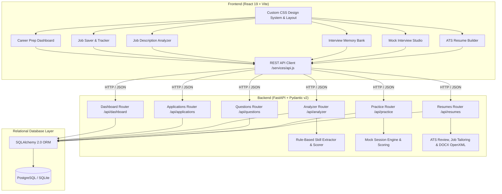

# SkillBridge — Student Career Preparation & Job Tracking Platform

SkillBridge is a comprehensive, production-ready career readiness platform built for college students and job seekers. It unifies application pipeline tracking, rule-based job description analysis, an interview question repository, and an interactive mock interview practice studio into one integrated workspace.

---

## 1. Student Problem Addressed

Job hunting for students and new graduates is notoriously fragmented:
- **Disorganized Pipelines**: Applications, deadlines, and communication logs are scattered across browser bookmarks, chaotic spreadsheets, and email inboxes.
- **Job Description Ambiguity**: Job postings list dozens of overlapping, ambiguous buzzwords, making it difficult for students to distinguish required skills from bonus preferences.
- **Scattered Interview Notes**: Real questions asked during campus drives and technical rounds are forgotten, and practice reflections are rarely preserved.
- **Unstructured Interview Practice**: Generic AI interview bots often hallucinate scores or lack targeted practice on the actual requirements of the applied role.

**SkillBridge solves this by closing the preparation loop:**
```text
Save a Job ➔ Analyze Requirements ➔ Identify Skill Gaps ➔ Log & Study Questions ➔ Practice in Mock Studio ➔ Review Performance & Improve
```

---

## 2. System Architecture



---

## 3. Core Modules & Capabilities

### Module 1: Unified Career Preparation Dashboard
- **Live Summary Metrics**: Real-time cards calculating total saved jobs, submitted applications, active interviews, offers received, upcoming deadlines, saved questions, confident mastery count, and completed mock interview sessions.
- **Application Funnel**: Visual pipeline categorizing active opportunities (`Saved` ➔ `Applied` ➔ `Assessment` ➔ `Interview` ➔ `Offer`) while properly separating final outcomes (`Rejected`, `Withdrawn`). Interactive bars navigate directly to pre-filtered job views.
- **Urgent Deadlines Tracker**: Chronologically sorted list of approaching deadlines with explicit badges (`Overdue`, `Urgent: ≤ 3 days`, `Approaching: ≤ 7 days`).
- **Skill-Gap Overview**: Aggregates missing required and preferred skills across all saved job analyses, surfacing high-frequency gap patterns with direct learning tasks.
- **Interview Preparation Overview**: Displays question review status breakdown (`New`, `Learning`, `Confident`), recent mock session outcomes, unmastered topics, and direct actions to resume in-progress sessions.
- **Recommended Next Steps**: Deterministic, rule-driven action engine that analyzes saved records to generate high-priority next actions (e.g., analyze unanalyzed jobs, review questions for upcoming interviews, practice missing required skills).

### Module 2: Job Saver & Application Tracker
- **Full CRUD Management**: Add, update, view, and delete job opportunities.
- **Dual View Modes**: Switch seamlessly between interactive Kanban Board view and sortable Data Table view.
- **Recruitment Lifecycle**: Track progression across 7 distinct stages: `Saved`, `Applied`, `Assessment`, `Interview`, `Offer`, `Rejected`, `Withdrawn`.
- **Search & Filtering**: Search across company, job title, and notes; filter by stage, work arrangement (`On-site`, `Hybrid`, `Remote`), and employment type (`Full-time`, `Internship`, `Part-time`).
- **Deep Integrations**: Direct buttons on every job card to trigger JD analysis, view logged interview questions, or launch a company-targeted mock interview.

### Module 3: Job Description Analyzer & Skill Matcher
- **Transparent Rule-Based Extraction**: Deterministic dictionary of 100+ modern industry skills spanning Programming, Frontend, Backend, Databases, Cloud/DevOps, AI/ML, and Mobile.
- **Alias Resolution**: Automatically normalizes synonyms (e.g., `JS` ➔ `JavaScript`, `React.js` ➔ `React`, `Postgres` ➔ `PostgreSQL`, `k8s` ➔ `Kubernetes`).
- **Requirement Segmentation**: Intelligently parses section headers to categorize skills into **Required** vs. **Preferred (Bonus)**.
- **Skill Coverage Formula**: Transparent weighted coverage scoring:
  $$\text{Score} = \min\left(100, \left( \frac{\text{Matched Required}}{\text{Total Required}} \times 80 \right) + \left( \frac{\text{Matched Preferred}}{\text{Total Preferred}} \times 20 \right) \right)$$
- **Prioritized Learning Checklist**: Converts detected skill gaps into actionable project recommendations with learning topics.
- **Persistent History**: View past analyses, inspect detailed skill breakdowns, and revisit recommendations at any time without mutating underlying job data.

### Module 4: Interview Memory Bank
- **Categorized Question Repository**: Organize questions by Round Type (`Technical`, `HR`, `Behavioral`, `System Design`, `Aptitude`) and Difficulty (`Beginner`, `Intermediate`, `Advanced`).
- **Personal Reflection Capture**: Record personal answers, expected answers, and post-interview improvement notes.
- **Mastery Review Status**: Mark questions as `New`, `Learning`, or `Confident` with quick status dropdowns.
- **Opportunity Association**: Link questions directly to tracked jobs with company name and job role badges.
- **Cross-Module Deep Linking**: Click "Practice in Mock Studio" on any question to launch an instant practice drill.

### Module 5: Mock Interview Practice Studio
- **Customized Session Setup**: Configure practice sessions by Round Type, Difficulty, Question Count (5, 10, 15), and optional Countdown Timer (5, 10, 15, 20 mins).
- **Targeted Personalization**: Link sessions to saved jobs to automatically pull relevant company questions and target missing skills identified by the analyzer.
- **Live Practice Runner**: Clean, distraction-free interface with keyboard navigation, live countdown timer, autosave, and question skipping.
- **STAR-Method Guidance**: In-context prompts for Situation, Task, Action, and Result formatting.
- **Transparent Self-Assessment**: Multi-criteria 1–5 rating rubric (Technical Correctness, Problem Solving, Clarity, Confidence) with structured reflections (`What went well`, `What was difficult`, `Need to learn`).
- **Data-Driven Session Reports**: Calculates attempted count, duration, completion rate, criteria score averages, strongest areas, areas for improvement, and actionable preparation tips without hallucinating scores.

### Module 6: ATS-Friendly Resume Builder
- **Dual-Pane Interactive Workspace**: Left-side structured multi-section form editor and right-side real-time live preview. Responsive mobile switcher allows seamless toggling between Editor, Preview, ATS Review, and Job Tailor views.
- **Multiple Named Drafts & Isolation**: Create, edit, save, rename, duplicate, and delete multiple drafts for different target career paths (e.g. Frontend Developer, Python Developer, Full-Stack Developer, Data Science Intern). Mutating one draft never overwrites or corrupts another.
- **Core Structured Sections**:
  - *Contact Info*: Full name, email, phone, location, LinkedIn, GitHub, and Portfolio URLs with real-time format validation.
  - *Professional Summary*: Role-targeted summary editor with verified student writing guidelines.
  - *Technical Skills*: Categorized tags (Programming Languages, Frontend, Backend, Databases, ML/Data Science, Tools, Coursework) with easy tag addition and removal.
  - *Education*: Chronological entries with institution, degree, field of study, dates, GPA/percentage, and relevant coursework.
  - *Projects*: Title, timeline, technologies used, repository URL, live demo URL, and achievement bullets with action-verb formulas.
  - *Experience & Internships*: Organization, job title, duration, location, and contributions. Can be omitted if the applicant has no formal work experience (avoiding forced fabrication).
  - *Optional Sections*: Toggleable and reorderable sections for Certifications, Achievements, Leadership, and Languages.
- **Enforced ATS-Friendly Formatting Rules**:
  - Single-column document layout with 100% natural top-to-bottom reading flow.
  - Standard conventional headings (SUMMARY, TECHNICAL SKILLS, EDUCATION, PROJECTS, EXPERIENCE, CERTIFICATIONS).
  - Clean typography (Calibri/standard sans-serif), standard date formats, and clean bullet lists.
  - 100% selectable, parseable text (zero tables used for positioning, zero floating text boxes, zero decorative charts, zero skill-rating bars).
- **Explainable ATS Quality Review**:
  - Rule-based 0–100 completeness and format score with explicit category breakdown bars.
  - Categorized findings: Critical Issues (red), Recommended Improvements (amber), and Optional Refinements (blue).
  - Phrasing analysis inspecting each bullet for strong action verbs (from a catalog of 50+ power verbs) and flagging vague phrases (e.g., "worked on", "helped with", "responsible for") with concrete replacement suggestions.
- **Job-Specific Resume Tailoring**:
  - Connects directly to saved job opportunities and the Job Description Analyzer.
  - Reuses transparent skill extraction to identify Present Keywords, Missing Required Keywords, and Missing Preferred Keywords.
  - Generates truthful alignment recommendations suggesting how to highlight genuine coursework or real project contributions without fabricating qualifications.
- **Export to PDF & DOCX**:
  - *Selectable PDF*: Dedicated `@media print` print stylesheet isolating `#resume-printable-document`, hiding all navigation, headers, and editor chrome, and outputting crisp, selectable text PDFs on standard Letter/A4 paper.
  - *Standard DOCX*: Native OpenXML Microsoft Word generator built with zero external binary dependencies. Outputs clean paragraphs, headings, and native bullets compatible with Microsoft Word, Google Docs, and ATS screeners.

---

## 4. Technology Stack

| Layer | Technology | Key Capabilities & Libraries |
| :--- | :--- | :--- |
| **Frontend** | React 19, JavaScript | Single Page Application, Context, Hooks |
| **Build & Tooling** | Vite 8, Oxlint | Sub-second HMR, optimized production chunks |
| **Routing** | React Router DOM v7 | Nested routes, query param deep linking, SPA fallbacks |
| **Styling** | Vanilla CSS | Custom design tokens, glassmorphism, responsive grid |
| **Icons** | Lucide React | Clean, accessible SVG iconography |
| **Backend** | Python 3.10+, FastAPI | High-performance ASGI framework, automatic OpenAPI docs |
| **Data Validation** | Pydantic v2 | Strict schema validation, datetime parsing, sanitization |
| **Server** | Uvicorn | ASGI server with hot reload |
| **ORM** | SQLAlchemy 2.0 | Declarative mapping, session management, pooling |
| **Database** | SQLite & PostgreSQL | SQLite for local zero-config dev; PostgreSQL for production |
| **Containerization** | Docker, Docker Compose | Multi-stage slim builds, Nginx static serving, health checks |

---

## 5. Project Directory Structure

```text
skillbridge/
├── .env.example                    # Global environment configuration template
├── .gitignore                      # Git ignore rules for Python, Node, DBs, and env
├── docker-compose.yml              # Multi-container local & production setup
├── render.yaml                     # Infrastructure-as-code for Render deployment
├── README.md                       # Comprehensive project documentation
├── database/
│   └── schema.sql                  # Raw SQL schema definition with constraints & seed
├── backend/
│   ├── .env.example                # Backend environment configuration template
│   ├── Dockerfile                  # Multi-stage production Python container
│   ├── requirements.txt            # Python dependencies (FastAPI, SQLAlchemy, psycopg2, etc.)
│   ├── skillbridge.db              # SQLite development database
│   ├── app/
│   │   ├── __init__.py
│   │   ├── main.py                 # FastAPI application, CORS middleware, route registration
│   │   ├── database.py             # Engine creation, connection pooling, and safe migrations
│   │   ├── models.py               # SQLAlchemy ORM models (User, Job, Question, Analysis, Session)
│   │   ├── schemas.py              # Pydantic validation and serialization schemas
│   │   ├── routers/
│   │   │   ├── health.py           # Health check endpoints
│   │   │   ├── dashboard.py        # Dashboard summary, funnel, deadlines, and recommendations
│   │   │   ├── applications.py     # Job Tracker CRUD and pipeline statistics
│   │   │   ├── analyzer.py         # Job Description Analyzer and history management
│   │   │   ├── questions.py        # Interview Memory Bank CRUD, filters, and stats
│   │   │   └── practice.py         # Mock Interview Studio session management and reports
│   │   └── services/
│   │       ├── skill_extractor.py  # Rule-based skill extraction and scoring engine
│   │       └── practice_service.py # Practice session generation, preview, and report engine
│   └── tests/
│       ├── test_analyzer.py        # 10 tests: Skill extraction, scoring, aliases, API
│       ├── test_questions.py       # 11 tests: Question CRUD, filters, review status, job links
│       ├── test_practice.py        # 16 tests: Practice setup, autosave, self-assessment, reports
│       ├── test_dashboard.py       # 3 tests: Dashboard summary, funnel stages, deadline sorting
│       └── test_integration.py     # 1 test: Complete 10-step student journey across all modules
└── frontend/
    ├── .env.example                # Frontend environment configuration template
    ├── Dockerfile                  # Multi-stage build with Nginx Alpine serving
    ├── nginx.conf                  # Nginx configuration with SPA routing & Gzip compression
    ├── package.json                # Frontend dependencies and build scripts
    ├── vite.config.js              # Vite server and backend proxy configuration
    ├── index.html                  # HTML entry point with modern typography
    ├── src/
    │   ├── main.jsx                # Application root
    │   ├── App.jsx                 # Routing layout and top-level navigation
    │   ├── components/             # Reusable UI components (Sidebar, Navbar, Modals, Cards)
    │   ├── pages/                  # Page views (Dashboard, Applications, Analyzer, Questions, Practice)
    │   ├── services/
    │   │   └── api.js              # Centralized Fetch API client with environment base URL
    │   └── styles/                 # Modular CSS stylesheets and design tokens
```

---

## 6. Local Setup Instructions

### Prerequisites
- Python 3.10 or higher
- Node.js 18 or higher (LTS recommended)
- Git

### Backend Setup
1. Open a terminal and navigate to the backend directory:
   ```bash
   cd backend
   ```
2. Create and activate a Python virtual environment:
   ```bash
   python3 -m venv venv
   source venv/bin/activate    # On Windows: venv\Scripts\activate
   ```
3. Install dependencies:
   ```bash
   pip install -r requirements.txt
   ```
4. Start the FastAPI backend server:
   ```bash
   uvicorn app.main:app --host 127.0.0.1 --port 8000 --reload
   ```
   The backend API will be available at `http://127.0.0.1:8000`. Interactive API documentation (Swagger UI) is available at `http://127.0.0.1:8000/docs`.

### Frontend Setup
1. In a new terminal window, navigate to the frontend directory:
   ```bash
   cd frontend
   ```
2. Install npm dependencies:
   ```bash
   npm install
   ```
3. Launch the Vite development server:
   ```bash
   npm run dev
   ```
   Open your browser and navigate to `http://localhost:5173`. The Vite dev server will proxy API requests to `http://127.0.0.1:8000`.

---

## 7. Environment Configuration

Copy `.env.example` to `.env` in the root, backend, or frontend as needed:

```bash
cp .env.example .env
```

| Variable | Default Value | Description |
| :--- | :--- | :--- |
| `DATABASE_URL` | `sqlite:///./skillbridge.db` | SQLAlchemy connection string. Set to `postgresql://...` for managed Postgres. |
| `ALLOWED_ORIGINS` | `http://localhost:5173,http://localhost:3000` | Comma-separated list of allowed CORS frontend origins. |
| `ENVIRONMENT` | `development` | Environment mode (`development`, `staging`, `production`). |
| `HOST` | `0.0.0.0` | Backend host binding. |
| `PORT` | `8000` | Backend port binding. |
| `VITE_API_URL` | `""` (empty) | Frontend backend API URL. Leave empty in development to use Vite proxy; set to backend URL in production. |

---

## 8. Database Architecture & Migrations

SkillBridge uses **SQLAlchemy 2.0 declarative models** that operate seamlessly across SQLite (for zero-config local development) and PostgreSQL (for production).

### Schema Relationships
- `users`: User entity (`id=1` seeded automatically as default demo student).
- `job_applications`: Stores job title, company, salary, location, work mode, deadline, status, and notes. Linked to `users.id` via `ON DELETE CASCADE`.
- `job_analyses`: Stores raw JD, extracted required/preferred skills, coverage scores, and recommendations. Linked to `job_applications.id` via `ON DELETE SET NULL`.
- `interview_questions`: Stores question text, category, difficulty, personal answer, expected answer, improvement notes, and review status. Linked to `job_applications.id` via `ON DELETE SET NULL`.
- `practice_sessions`: Tracks mock interview configurations, timer, duration, and status. Linked to `job_applications.id` via `ON DELETE SET NULL`.
- `practice_answers`: Records individual answers, attempt flags, duration, STAR reflections, and 1–5 self-ratings. Linked to `practice_sessions.id` via `ON DELETE CASCADE`.
- `resumes`: Stores resume title, target role, target job ID, template ID, contact info (JSON), summary, categorized skills (JSON), education (JSON), projects (JSON), experience (JSON), additional sections (JSON), and section configuration (JSON). Linked to `users.id` via `ON DELETE CASCADE` and `job_applications.id` via `ON DELETE SET NULL`.

### Non-Destructive Integrity Guarantee
- Deleting an analysis, mock interview session, or resume **never deletes or alters** the underlying job application or interview question.
- Deleting a job application automatically nullifies foreign keys (`job_id = NULL` / `target_job_id = NULL`) on associated interview questions, practice sessions, and resumes, preserving personal preparation notes and resume content intact.

---

## 9. API Endpoint Reference

| Method | Endpoint | Description |
| :--- | :--- | :--- |
| **GET** | `/api/health` | Service health status and database connectivity |
| **GET** | `/api/dashboard/summary` | Real-time summary cards, funnel data, deadlines, skill gaps, prep metrics, and recommendations |
| **GET** | `/api/applications` | List saved jobs with search, stage filter, and sorting |
| **POST** | `/api/applications` | Create a new job opportunity |
| **GET** | `/api/applications/{id}` | Retrieve single job application details |
| **PUT** | `/api/applications/{id}` | Update job application details and recruitment stage |
| **DELETE** | `/api/applications/{id}` | Delete a job application |
| **GET** | `/api/applications/stats/summary` | Job tracker stage breakdown and deadline counts |
| **POST** | `/api/analyzer/analyze` | Analyze job description vs. resume with rule-based scoring |
| **GET** | `/api/analyzer/history` | List saved analysis history items |
| **GET** | `/api/analyzer/history/{id}` | Retrieve single saved analysis breakdown |
| **DELETE** | `/api/analyzer/history/{id}` | Delete saved analysis history item |
| **GET** | `/api/questions` | List interview questions with multi-facet filters |
| **POST** | `/api/questions` | Create a new interview question record |
| **GET** | `/api/questions/{id}` | Retrieve interview question details and notes |
| **PUT** | `/api/questions/{id}` | Update question text, answers, and reflection notes |
| **PATCH** | `/api/questions/{id}/status` | Quick toggle review status (`New`, `Learning`, `Confident`) |
| **DELETE** | `/api/questions/{id}` | Delete interview question |
| **GET** | `/api/questions/stats` | Question bank round, difficulty, and review status stats |
| **POST** | `/api/practice/preview` | Preview question matching and targeted skills before starting session |
| **POST** | `/api/practice/sessions` | Configure and start a new mock interview session |
| **GET** | `/api/practice/sessions` | List previous mock interview sessions |
| **GET** | `/api/practice/sessions/{id}` | Retrieve active session details and questions |
| **PUT** | `/api/practice/sessions/{id}/answers/{aid}`| Autosave answer text, STAR reflection, and self-ratings |
| **POST** | `/api/practice/sessions/{id}/finish` | Complete practice session and calculate performance report |
| **POST** | `/api/practice/sessions/{id}/resume` | Resume an in-progress practice session |
| **GET** | `/api/practice/sessions/{id}/report` | Retrieve completed session performance report |
| **DELETE** | `/api/practice/sessions/{id}` | Delete practice session and its answer records |
| **GET** | `/api/resumes` | List all resume drafts for the user |
| **POST** | `/api/resumes` | Create a new structured resume draft |
| **GET** | `/api/resumes/sample` | Retrieve pre-configured entry-level sample resume |
| **GET** | `/api/resumes/{id}` | Retrieve single resume draft and section configuration |
| **PUT** | `/api/resumes/{id}` | Update resume draft contents and section order |
| **POST** | `/api/resumes/{id}/duplicate` | Duplicate resume draft into an isolated new copy |
| **DELETE** | `/api/resumes/{id}` | Delete resume draft safely |
| **POST** | `/api/resumes/{id}/review` | Run transparent rule-based ATS quality review and phrasing audit |
| **POST** | `/api/resumes/{id}/tailor/{job_id}` | Tailor resume against saved job requirements and get alignment advice |
| **GET** | `/api/resumes/{id}/export/docx` | Download standard OpenXML Microsoft Word document |

---

## 10. Automated Testing & Verification

The backend includes a comprehensive, automated test suite covering all modules, regression boundaries, and integration workflows.

### Running Backend Tests
Execute the test runner from the `backend` directory:
```bash
cd backend
venv/bin/python -m unittest discover -s tests -p "test_*.py" -v
```

**Results:**
- `test_analyzer.py`: 10 tests passed (Skill extraction, aliases, scoring, validation, regression)
- `test_questions.py`: 11 tests passed (Question CRUD, search, filters, review status, job association)
- `test_practice.py`: 16 tests passed (Preview, session creation, autosave, skipping, ratings validation, report calculation, history, non-mutation)
- `test_dashboard.py`: 3 tests passed (Summary cards structure, funnel pipeline separation, urgency deadline sorting)
- `test_integration.py`: 1 test passed (Full 10-step multi-module student workflow)
- `test_resumes.py`: 10 tests passed (Resume CRUD, isolation, duplication, non-destructive deletion, ATS review, job tailoring, OpenXML docx validity, sample template, 404 handling)
- **Total: 51 tests passed in 0.527s (0 failures, 0 errors)**.

### Running Frontend Checks
```bash
cd frontend
npm run lint      # Runs Oxlint (0 errors)
npm run build     # Runs Vite production build (0 errors, 1953 modules transformed)
```

---

## 11. Deployment Guide

### Option A: Containerized Deployment with Docker Compose
Run the entire production stack (PostgreSQL + FastAPI + Nginx React Frontend) with one command:
```bash
docker-compose up --build -d
```
- Frontend: `http://localhost:80`
- Backend API: `http://localhost:8000`
- PostgreSQL: `localhost:5432`

### Option B: Cloud Deployment (Render / Railway / Fly.io)
The repository includes a ready-to-deploy `render.yaml` specification:
1. Push repository to GitHub.
2. Link repository to Render as a **Blueprint**.
3. Render automatically provisions:
   - A managed PostgreSQL 16 database.
   - A Python web service running Uvicorn with auto-migrations.
   - A static frontend site serving the Vite production bundle with SPA rewrites.

---

## 12. Portfolio Demonstration Flow

To demonstrate SkillBridge during placements or technical interviews:
1. **Open Dashboard (`/`)**: View live summary cards, application funnel breakdown, approaching deadlines, aggregate skill gaps, and resume draft status.
2. **Build an ATS Resume (`/resume-builder`)**: Create a role-specific resume draft, add real course projects, tailor against a saved job, review the ATS quality score and action-verb insights, and export both a selectable PDF and native `.docx` document.
3. **Save an Opportunity (`/applications`)**: Add a new job (e.g., "Full Stack Engineer at Google"), set a deadline, and view it in Kanban mode.
4. **Analyze Job Description (`/job-analyzer`)**: Click "Analyze JD" on the saved job. Paste a realistic description to view extracted required vs. preferred skills, coverage score, and the prioritized learning checklist.
5. **Log an Interview Question (`/questions`)**: Save a technical question encountered during an interview, link it to the job, record STAR-method notes, and mark it as `Learning`.
6. **Rehearse in Mock Studio (`/practice`)**: Start a targeted mock interview session for the company. Answer questions, use the countdown timer, provide honest 1–5 ratings across rubric criteria, and finish the session.
7. **Inspect Performance Report & Revisit Dashboard**: Review the detailed session report, then return to the Dashboard to observe all summary metrics and next-step recommendations automatically updated.

---

## 13. Suggested Portfolio Screenshots

To make your GitHub repository stand out to recruiters, include screenshots of:
1. **Career Preparation Dashboard**: Displaying active metrics, colorful application funnel, upcoming deadline tags, and recommended next steps.
2. **ATS-Friendly Resume Builder Workspace**: Showing side-by-side structured editor, live single-column ATS preview, and quality score dial.
3. **Job Tailoring & Keyword Matching Panel**: Highlighting present keywords, missing required skills, and truthful alignment suggestions.
4. **Job Application Kanban & Table Views**: Demonstrating status transitions and multi-criteria filters.
5. **Job Description Analyzer Results**: Showing skill badges (matching vs. missing) and coverage percentage circle.
6. **Mock Interview Studio Live Runner**: Displaying the timer, question card, STAR framework prompts, and self-assessment sliders.
7. **Mock Performance Summary Report**: Showcasing score breakdowns, strongest areas, and recommendations.

---

## 14. Resume Contribution Notes

Use these bullet points for your technical resume or LinkedIn profile:

- **Full-Stack Career Preparation Platform (React 19, FastAPI, PostgreSQL, SQLAlchemy)**: Architected and deployed an integrated career preparation web app with 6 core modules: application tracking, JD analysis, question bank, mock interview studio, ATS resume builder, and real-time dashboard.
- **ATS-Friendly Resume Builder & OpenXML Generator**: Engineered a single-column resume builder with real-time live preview, multi-draft isolation, rule-based formatting audits, and native Microsoft Word (`.docx`) OpenXML export without third-party binary dependencies.
- **Job Tailoring & Keyword Matching Engine**: Developed a transparent skill comparison algorithm matching candidate project experience against employer JD requirements, recommending truthful alignment strategies without hallucinating claims.
- **Rule-Based Job Description Analysis Engine**: Engineered a transparent, deterministic skill-extraction engine covering 100+ technical skills and aliases, segmenting required vs. preferred qualifications and computing accurate skill-coverage scores.
- **Interactive Mock Interview Studio & Scoring Rubric**: Built a practice studio featuring live timers, STAR-method answer guidance, autosave, and multi-criteria self-assessment analytics without hallucinated AI metrics.
- **Data Integrity & Test Automation**: Implemented relational schema constraints with SQLAlchemy 2.0 (PostgreSQL/SQLite dual-engine), achieving 100% test pass rate across 51 unit and end-to-end integration tests.

---

## 15. Known Limitations & Roadmap

- **Authentication Model**: Currently configured for a single-user demo environment (`user_id = 1`). For public multi-user deployment, an authentication layer (JWT tokens + bcrypt password hashing) should be enabled before public write access.
- **Score Transparency**: The resume review score (0–100) and keyword match score evaluate objective formatting rules, section completeness, and vocabulary overlap. They are not official hiring scores and do not claim to guarantee employment or predict arbitrary proprietary third-party ATS algorithms.
- **AI Integrations**: Current skill extraction and interview guidance are strictly rule-based and transparent by design to prevent AI hallucination; future extensions can integrate opt-in LLM feedback for deeper answer critiques.
- **Calendar Synchronization**: Application deadlines currently trigger visual notifications on the dashboard; future iterations can export deadlines to `.ics` or Google Calendar.
